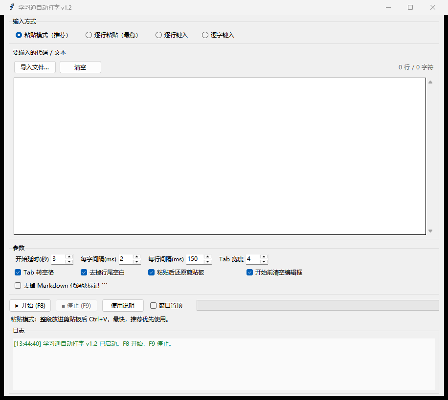
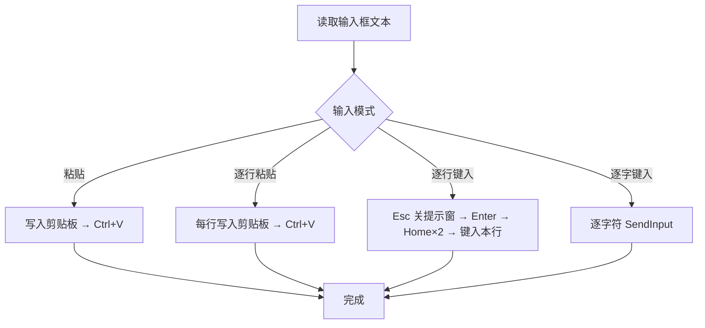

# 学习通自动打字

[](https://www.python.org/)
[](#环境要求)
[](#环境要求)
[](LICENSE)

面向超星学习通等**网页代码编辑器**的自动输入工具。把整段代码一次性粘贴或用模拟按键逐行输入，
自动规避网页编辑器"回车继承缩进""代码提示吞回车""自动补全括号"等一系列会破坏代码的行为。

> 纯 Python 标准库实现（`tkinter` + `ctypes`），**零第三方依赖**，无需联网。



---

## 目录

- [背景与动机](#背景与动机)
- [核心特性](#核心特性)
- [工作原理](#工作原理)
- [环境要求](#环境要求)
- [快速开始](#快速开始)
- [使用说明](#使用说明)
- [常见问题](#常见问题)
- [安全设计](#安全设计)
- [项目结构](#项目结构)
- [开发与测试](#开发与测试)
- [打包为可执行文件](#打包为可执行文件)
- [更新日志](#更新日志)
- [贡献](#贡献)
- [免责声明](#免责声明)
- [许可证](#许可证)

---

## 背景与动机

在记事本里输入代码一切正常，但粘贴到学习通的在线代码框后，代码会"每换一行往右缩进一截"，
甚至出现整行被覆盖、代码挤成一团的情况。原因是网页代码编辑器（CodeMirror / Ace 一类）与
普通文本框的行为不同：

| 行为 | 记事本 | 网页代码编辑器 |
| --- | --- | --- |
| 回车 | 插入一个换行 | `newlineAndIndent`：换行 **并继承当前行缩进** |
| 代码提示 | 无 | 弹窗打开时，回车被用于"接受候选"，换行不会发生 |
| 括号引号 | 原样输入 | 自动补全 `()`、`""`，可能产生多余字符 |

于是"逐字模拟输入"会在每一行叠加两份缩进：

```text
实际缩进 = 编辑器自动继承的缩进 + 输入工具又敲了一遍的源码缩进
```

本项目通过"整段粘贴"绕开回车逻辑，或在逐行输入时主动消除继承缩进、按 Esc 关闭提示弹窗，
从而让输入结果与源文本完全一致。

---

## 核心特性

- **四种输入模式**：整段粘贴、逐行粘贴、逐行键入、逐字键入，按场景自由选择。
- **粘贴优先设计**：`Ctrl+V` 是原样插入，不触发自动缩进与自动补全，是最稳妥的路径。
- **逐行键入防干扰**：每次回车前按 `Esc` 关闭代码提示弹窗；回车后按两次 `Home` 回到第 0 列，
  再输入本行自己的缩进。
- **开始前清理**：可选发送 `Ctrl+A` + `Delete` 清空编辑框，避免上次残留内容与新内容混在一起。
- **全局热键**：`F8` 开始、`F9` 停止，独立线程注册，不依赖窗口焦点。
- **防误输入**：开始与逐行输入过程中检测前台窗口，焦点回到本程序立即中止。
- **文本预处理**：自动展开 Tab、去除行尾空白、剥离 Markdown 代码围栏。
- **配置持久化**：输入内容与全部参数保存在 `%APPDATA%\学习通自动打字\config.json`，下次启动自动恢复。
- **完全离线**：不联网、不写注册表、不收集任何数据。

---

## 工作原理

### 输入流程



### 关键技术点

| 问题 | 对策 |
| --- | --- |
| 回车自动继承缩进 | 粘贴模式不按回车；逐行键入按两次 `Home` 回到第 0 列后再输入本行缩进 |
| 代码提示弹窗吞掉回车 | 每次回车前先发送 `Esc`（提示弹窗在 Esc 下会关闭） |
| 编辑框残留旧内容 | 开始前发送 `Ctrl+A` + `Delete`（可在参数中关闭） |
| 逐字输入误删整行 | v1.1 起取消"选中并删除自动缩进"的步骤，改为只回行首、不删除内容 |
| Tab 抢走焦点 | 输入前将 `\t` 展开为空格（默认宽度 4） |
| 中文字符输入 | 使用 `SendInput` 的 `KEYEVENTF_UNICODE` 事件，绕过输入法直接投递 Unicode 字符 |
| 模拟按键被系统拦截 | 检测 `SendInput` 返回值，连续失败时提示以管理员身份运行 |

键盘事件通过 `SendInput` 构造 `KEYBDINPUT` 投递；剪贴板通过 `OpenClipboard` /
`SetClipboardData(CF_UNICODETEXT)` 读写；全局热键在独立线程中以 `RegisterHotKey` 注册，
并运行自己的 `GetMessage` 消息循环，避免被 Tk 的消息泵吞掉。

---

## 环境要求

| 项目 | 要求 |
| --- | --- |
| 操作系统 | Windows 10 / 11（依赖 Win32 API） |
| Python | 3.8 及以上，需包含 `tkinter`（官方安装包默认包含） |
| 第三方库 | 无 |
| 权限 | 常规权限即可；若浏览器/学习通以管理员身份运行，本程序也需同样提权 |

---

## 快速开始

```bash
git clone <repository-url>
cd 学习通自动打字
python 学习通自动打字.py
```

Windows 下也可以直接双击 `启动.bat`（优先使用 `pythonw` 启动，不弹出控制台）。

不熟悉 Git 时，可直接在仓库页面点击 **Code → Download ZIP**，解压后运行 `启动.bat`。

使用步骤：

1. 将代码粘贴到上方文本框，或点击 **导入文件…**；
2. 选择 **粘贴模式（推荐）**，确认 **开始前清空编辑框** 已勾选；
3. 点击 **▶ 开始 (F8)**，在 3 秒倒计时内点击学习通的代码编辑框；
4. 输入过程中可随时按 **F9** 停止。

> 提示：开始后请确保浏览器中的**代码编辑框获得焦点**，而不是页面空白处。

---

## 使用说明

### 输入模式

| 模式 | 实现方式 | 适用场景 |
| --- | --- | --- |
| **粘贴模式**（默认） | 整段写入剪贴板，发送 `Ctrl+V` | 首选。最快，且完全不触发自动缩进、提示弹窗与括号补全 |
| **逐行粘贴** | 每行单独写入剪贴板并 `Ctrl+V`，全程不按回车 | 希望看到逐行出现、同时要求结果 100% 精确 |
| **逐行键入** | `Esc` → `Enter` → `Home`×2 → 输入本行缩进与正文 | 必须模拟真实键入的场合 |
| **逐字键入** | 原样逐字符投递按键 | 记事本、Word 等无自动缩进的普通文本框 |

> 逐行键入会在行尾留下编辑器自动补的空白字符（不可见，不影响 Python 语法）。
> 若需要完全无冗余字符，请使用逐行粘贴。

### 全局快捷键

| 快捷键 | 功能 |
| --- | --- |
| `F8` | 开始输入（含倒计时） |
| `F9` | 立即停止 |

热键在独立线程注册；若被其他程序占用，界面日志会给出提示，此时仍可使用界面按钮操作。

### 参数说明

| 参数 | 默认值 | 说明 |
| --- | --- | --- |
| 开始延时 | 3 秒 | 点击开始后预留的切窗与聚焦时间 |
| 每字间隔 | 2 ms | 逐字/逐行模式下字符之间的停顿，出现丢字时调大 |
| 每行间隔 | 150 ms | 回车后等待编辑器完成自动缩进的时间，编辑器卡顿时调大 |
| Tab 宽度 | 4 | 将 `\t` 展开为空格的数量 |
| Tab 转空格 | 开 | 避免 Tab 键改变焦点 |
| 去掉行尾空白 | 开 | 输入前清理源文本每行末尾的空白 |
| 粘贴后还原剪贴板 | 开 | 输入结束后恢复原有剪贴板内容 |
| 开始前清空编辑框 | 开 | 开始前发送 `Ctrl+A` + `Delete` |
| 去掉 Markdown 代码块标记 | 关 | 自动剔除聊天软件复制代码时附带的代码围栏行 |

---

## 常见问题

<details>
<summary><b>为什么在记事本里正常，粘贴到学习通就不断右移？</b></summary>

记事本的回车只插入换行；网页编辑器的回车会连同当前行缩进一起复制到新行。
逐字输入时源码自带的前导空格又会被再次输入一遍，于是每行多叠一层。

</details>

<details>
<summary><b>为什么会出现整行被覆盖、代码挤在一起？</b></summary>

两个原因叠加：

1. 编辑器的**代码提示弹窗**打开时，回车被用于"接受候选"，换行没有发生；
2. 编辑框中残留了上一次的代码，新内容插入到了旧内容中间。

v1.2 起，回车前会先按 `Esc` 关闭提示弹窗，并在开始前清空编辑框。

</details>

<details>
<summary><b>提示"全局热键注册失败"怎么办？</b></summary>

`F8` / `F9` 已被其他程序占用（常见于旧实例尚未退出）。关闭冲突程序或旧窗口后重新打开本工具；
不注册热键时，界面按钮仍可正常使用。

</details>

<details>
<summary><b>提示"系统拒绝了模拟按键"怎么办？</b></summary>

目标程序（浏览器）以管理员权限运行时会拦截低权限进程的模拟输入。
右键本程序选择"以管理员身份运行"即可。

</details>

<details>
<summary><b>粘贴后学习通仍然重新排版缩进？</b></summary>

说明该编辑器对粘贴内容启用了自动重排。此时可改用逐行粘贴，
或在浏览器开发者工具中直接向编辑器实例写入文本。

</details>

<details>
<summary><b>中文注释或中文串出现乱码？</b></summary>

本工具通过 Unicode 事件直接投递字符，通常不受输入法影响。
若仍异常，请确认输入法处于英文模式，或改用粘贴模式。

</details>

---

## 安全设计

- **前台窗口守卫**：倒计时结束时若前台窗口仍是本程序，直接中止；逐行输入过程中检测到焦点回到本程序，
  立即停止。
- **销毁性操作最小化**：逐行键入不做任何"选中并删除"动作，最坏情况只是行尾多出若干空格。
- **清空操作的作用范围**：`Ctrl+A` 在代码框内只选中代码；在普通页面上仅选中网页文字，
  `Delete` 对非可编辑内容无效。
- **本地化存储**：仅读写 `%APPDATA%\学习通自动打字\config.json`，不写注册表、不联网。
- **无后台驻留**：程序退出即结束全部线程，不常驻、不自动启动。

---

## 项目结构

```text
学习通自动打字/
├── 学习通自动打字.py      # 主程序（单文件，约 900 行）
├── 启动.bat               # 双击启动脚本
├── selftest_sim.py        # 仿真测试：模拟自动缩进编辑器，校验四种模式
├── docs/
│   └── preview.png        # 界面截图
├── .gitignore
├── LICENSE
└── README.md
```

程序分为三层：

| 层次 | 内容 |
| --- | --- |
| Win32 封装 | `SendInput` 键盘事件、剪贴板读写、`RegisterHotKey` 热键线程 |
| 输入引擎 | `TypingJob` 线程，实现四种输入模式与中止、进度、焦点检测 |
| 图形界面 | `tkinter` + `ttk`，参数配置、日志、进度条、配置持久化 |

---

## 开发与测试

`selftest_sim.py` 会构造一个"回车自动缩进"的模拟编辑器（`tkinter.Text` + 自定义 `<Return>` 绑定），
把真实的 `press` / `send_char` / `send_ctrl_v` 替换为直接操作控件的桩函数，从而在不发送任何真实按键的前提下
验证四种模式的输出结果。

```bash
python selftest_sim.py
cat selftest_result.txt        # Windows: type selftest_result.txt
```

预期输出：

```text
clipboard ok
[paste] MATCH done=[('完成（粘贴模式）',)]
[line_paste] MATCH done=[('完成（逐行粘贴）',)]
[line] MATCH(仅行尾空格) done=[('完成（逐行键入）',)]
[char] 预期跑偏（该模式只给记事本用） done=[('完成（逐字模式）',)]
```

其中逐字模式在自动缩进编辑器上"跑偏"是设计使然，用于说明该模式的适用范围。

---

## 打包为可执行文件

```bash
python -m pip install pyinstaller
pyinstaller -F -w -n 学习通自动打字 学习通自动打字.py
```

生成的 `dist\学习通自动打字.exe` 可脱离 Python 运行。`-w` 表示不显示控制台窗口。

---

## 更新日志

### v1.2

- 逐行键入在每次回车前先发送 `Esc`，关闭代码提示弹窗，避免回车被吞导致行合并。
- 新增"开始前清空编辑框"（`Ctrl+A` + `Delete`），防止残留代码与新内容混杂。
- 默认每行间隔提升至 150 ms；旧版配置载入时自动上调。

### v1.1

- 移除逐行键入中"`Shift+End` + `Delete` 清除自动缩进"的步骤。
  该步骤在回车未生效时会把刚输入的一行整行删除，表现为"输入完又被覆盖"。
- 改为只回行首、不删除任何内容。
- 新增"逐行粘贴"模式。

### v1.0

- 首个版本：粘贴模式、逐行键入、逐字键入；全局热键、焦点守卫、配置持久化。

---

## 贡献

欢迎通过 Issue 反馈问题。提交时请尽量附上：

- 学习通编辑器的表现（截图或录屏）与复现步骤；
- 使用的输入模式、参数，以及程序日志中的提示信息；
- 操作系统与 Python 版本。

提交 Pull Request 前，请确认 `python selftest_sim.py` 全部通过。

---

## 免责声明

本项目仅供**个人学习与技术研究**使用，用于验证"网页编辑器自动缩进"这一现象的成因与规避方法。

使用者应遵守所在学校、教师及超星学习通平台的各项规定。**禁止将本工具用于考试、测评或其他
被明令禁止自动输入的场合**。因使用本工具产生的任何后果（包括但不限于作业被判无效、账号处罚等）
由使用者自行承担，作者不承担任何责任。

---

## 许可证

本项目基于 [MIT License](LICENSE) 开源。
